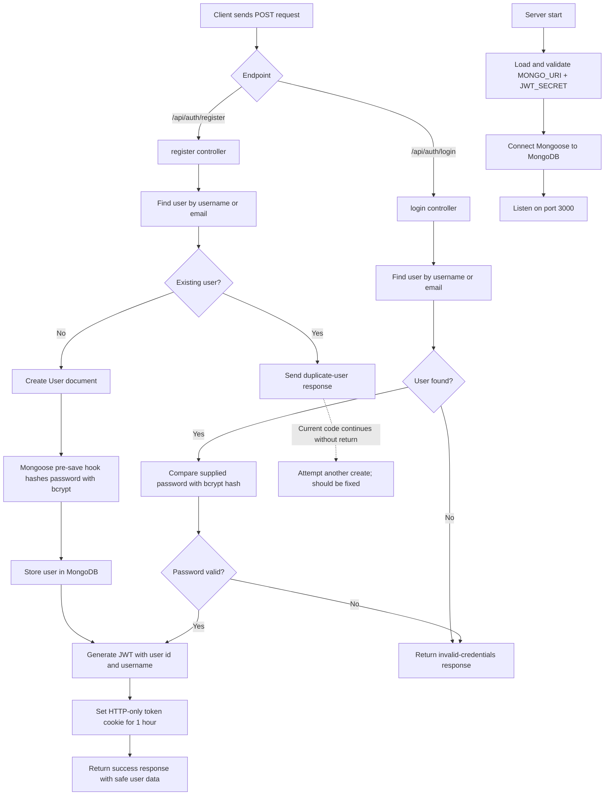

# Insta Lite One — Authentication API Practice

A small Node.js backend created to practise a complete authentication flow: accepting user credentials, storing users in MongoDB, hashing passwords, creating JSON Web Tokens (JWTs), and returning the JWT in an HTTP-only cookie.

> This repository currently exposes authentication endpoints only. Despite the project name, there are no post, feed, profile, or media-upload features yet.

## What this project demonstrates

- Structuring an Express application into configuration, model, controller, route, and utility layers.
- Connecting an application to MongoDB with Mongoose.
- Creating and querying user records.
- Hashing passwords with `bcryptjs` before they are saved.
- Checking a supplied password safely at login.
- Signing JWTs and storing them in HTTP-only cookies.
- Reading environment variables with `dotenv` and failing early when required secrets are absent.

## Technology

| Tool | Purpose in this project |
| --- | --- |
| Node.js (ES modules) | Runtime and module system |
| Express 5 | HTTP server, middleware, and routing |
| MongoDB + Mongoose | Database connection and `User` model |
| bcryptjs | Password hashing and comparison |
| jsonwebtoken | JWT signing and verification |
| cookie-parser | Cookie parsing middleware for future protected routes |
| dotenv | Loads `.env` configuration |
| morgan | Development request logging |
| nodemon | Restarts the development server when files change |

## Project structure

```text
project-lite-one/
├── server.js                         # Starts the database connection and HTTP server
├── package.json                      # Dependencies and npm scripts
└── src/
    ├── app.js                        # Builds and configures the Express application
    ├── config/
    │   ├── config.js                 # Loads and validates environment configuration
    │   └── db.js                     # Connects Mongoose to MongoDB
    ├── controllers/
    │   └── auth.controller.js        # Registration and login request handlers
    ├── models/
    │   └── user.model.js             # User schema, password hook, comparison method
    ├── routes/
    │   ├── index.routes.js            # Mounts feature routers
    │   └── auth.routes.js             # Defines authentication endpoints
    └── utils/
        └── auth.utils.js              # JWT generation and verification helpers
```

## Getting started

### Prerequisites

- Node.js 18 or later
- A MongoDB database (local MongoDB or MongoDB Atlas)

### Install and run

```bash
git clone https://github.com/PiyushKadam2006/project-lite-one.git
cd project-lite-one
npm install
```

Create a `.env` file in the repository root:

```env
MONGO_URI=mongodb://127.0.0.1:27017/insta-lite-one
JWT_SECRET=replace-this-with-a-long-random-secret
NODE_ENV=development
```

Then start the development server:

```bash
npm run dev
```

The API listens at `http://localhost:3000`.

## API reference

All routes are mounted under `/api`.

### Register a user

`POST /api/auth/register`

Request body:

```json
{
  "username": "piyush",
  "email": "piyush@example.com",
  "password": "your-strong-password"
}
```

Successful response (`201 Created`):

```json
{
  "messege": "User register successfully ",
  "user": {
    "id": "<mongo-object-id>",
    "username": "piyush",
    "email": "piyush@example.com"
  }
}
```

The response also sets a `token` cookie that is HTTP-only, lasts one hour, and uses `secure: true` in production.

### Log in

`POST /api/auth/login`

Request body:

```json
{
  "username": "piyush",
  "email": "piyush@example.com",
  "password": "your-strong-password"
}
```

The current lookup accepts either a matching username **or** email. You can therefore send one identifier; however, the code currently calls `.toLowerCase()` on both values, so sending only one will throw. For the current implementation, send both fields or add input validation before using the API in real applications.

Successful response (`200 OK`) returns the user details and sets a fresh `token` cookie.

## Complete workflow



## How the request moves through the code

1. `server.js` loads the Express app, waits for `connectDB()`, and then starts port `3000`.
2. `src/app.js` adds cookie parsing, HTTP request logging, JSON-body parsing, and mounts all routes at `/api`.
3. `src/routes/index.routes.js` sends `/api/auth/*` traffic to `auth.routes.js`.
4. `src/routes/auth.routes.js` chooses the `register` or `login` controller.
5. The controller uses `userModel` to read or write MongoDB data.
6. During registration, the Mongoose pre-save hook hashes the password before MongoDB receives it.
7. After successful registration or login, `generateToken()` signs a JWT; the controller places it in an HTTP-only cookie.

## Current learning notes and recommended next improvements

These are observations about the existing code, not features already implemented.

- **Return after duplicate detection.** In `register`, the duplicate-user response is sent but execution continues to `userModel.create()`. Change it to `return res.status(400)...` so the handler stops cleanly.
- **Validate request data.** Validate that username/email/password exist and are strings before calling `.toLowerCase()`. A library such as Zod, Joi, or express-validator would help.
- **Do not make passwords unique.** `password` is marked `unique: true` in the schema. Different users should be allowed to choose the same password; remove this index.
- **Add central error handling.** Database, JWT, and validation errors currently have no shared Express error middleware.
- **Use consistent response spelling.** Response keys currently use `messege`; rename to `message` when you are ready to make an API-breaking cleanup.
- **Add protected routes.** `verifiToken` (likely intended as `verifyToken`) is defined but unused. A JWT middleware using it would protect profile or post routes.
- **Add tests and a production start script.** The project currently has only `dev`; add automated route tests and a `start` command.
- **Consider a login identifier field.** Instead of requiring both username and email, accept a single `identifier` value and query it against both fields.

## Why each function and field exists

### Functions and middleware

| Item | Why it exists |
| --- | --- |
| `connectDB()` | Opens the MongoDB connection before the app begins accepting requests. |
| `app.listen(3000)` | Makes the Express API reachable on port 3000. |
| `express.json()` | Converts JSON request bodies into `req.body`, so controllers can read credentials. |
| `cookieParser()` | Parses incoming cookies; useful when future protected endpoints need to read the JWT cookie. |
| `morgan('dev')` | Logs each request during development for easy debugging. |
| `userSchema.pre('save')` | Runs automatically before saving a user so raw passwords are never deliberately stored in the database. |
| `comparePassword(candidatePassword)` | Compares a login password with its bcrypt hash without exposing or decrypting the stored hash. |
| `generateToken({ id, username })` | Creates a signed, one-hour JWT that identifies the authenticated user. |
| `verifiToken(token)` | Verifies and decodes a JWT; it is ready for use in authentication middleware, though unused today. |
| `register(req, res)` | Handles account creation, duplicate checking, user creation, token creation, and the registration response. |
| `login(req, res)` | Finds a user, checks the password, creates a token, and returns a login response. |

### Configuration fields

| Field | Why it exists |
| --- | --- |
| `MONGO_URI` | Tells Mongoose which MongoDB database to connect to. It is kept in environment variables so connection details are not committed. |
| `JWT_SECRET` | Secret key used to sign and verify tokens. It must stay private, otherwise tokens could be forged. |
| `NODE_ENV` | Controls whether the token cookie uses the `secure` flag; production requires HTTPS. |

### User document fields

| Field | Why it exists | Current behavior |
| --- | --- | --- |
| `username` | Human-readable account identifier. | Required, unique, trimmed, and lowercased. |
| `email` | Contact/login identifier for an account. | Required, unique, trimmed, and lowercased. |
| `password` | Credential used to prove account ownership. | Required and bcrypt-hashed before save. The current `unique: true` setting should be removed. |
| `_id` | MongoDB’s automatic unique record identifier. | Included in the JWT and returned to the client as `id`. |

### Cookie fields

| Cookie option | Why it exists |
| --- | --- |
| `httpOnly: true` | Prevents browser JavaScript from reading the token, reducing exposure during XSS attacks. |
| `secure: NODE_ENV === 'production'` | Sends the cookie only over HTTPS in production. |
| `sameSite: 'strict'` | Limits when browsers attach the cookie across sites, helping reduce CSRF risk. |
| `maxAge: 3600000` | Expires the cookie after one hour, matching the JWT expiry. |

## License

The repository currently declares the ISC license in `package.json`.
